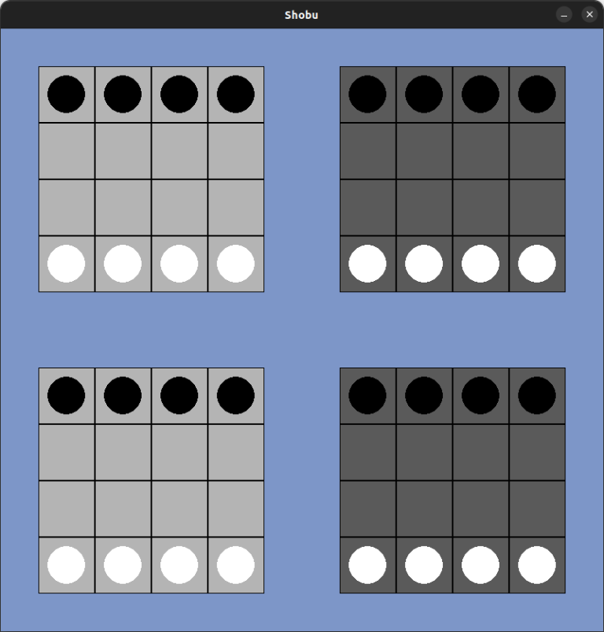
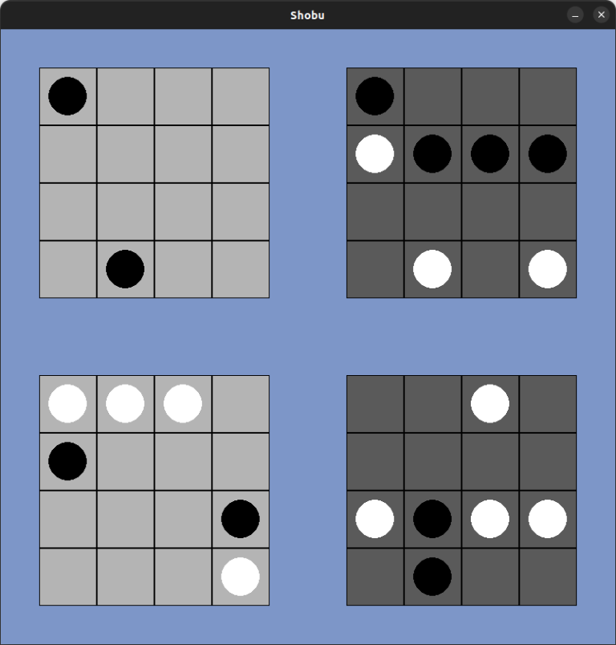

<div align="center">

# Artificial Intelligence Projects

*Four practical projects exploring search, adversarial games, constraint solving, and propositional logic*


[Overview](#about) • [Part 1: Pacman](#part-1-pacman-search) • [Part 2: Shobu](#part-2-shobu-game-and-ai) • [Part 3: N-Amazons](#part-3-n-amazons) • [Part 4: Logic and Constraints](#part-4-propositional-logic-and-constraint-solving) • [Setup](#setup)

</div>

---

## About

This repository brings together four projects developed for **Artificial Intelligence**. Each part applies a different AI technique to a concrete problem, from navigating a maze to building game-playing agents and encoding puzzles as logical constraints.

| Part | Project | Main concepts |
|------|---------|---------------|
| 1 | Pacman solver | State-space search, DFS, BFS, tree search, graph search |
| 2 | Shobu | Game-state modeling, minimax, alpha-beta pruning, agent evaluation |
| 3 | N-Amazons | Constraint modeling, heuristic search, A* |
| 4 | Logic and constraint solving | SAT, propositional logic, MiniSat, constraint programming |

## Part 1: Pacman Search

The Pacman solver models a grid-based fruit-collection problem as a state-space search task. It generates legal moves, applies them to states, and searches for a path that collects all fruit.

The project explores and compares four uninformed search configurations:

- Depth-first tree search (DFS)
- Breadth-first tree search (BFS)
- Depth-first graph search
- Breadth-first graph search

The provided instances make it possible to compare search time, explored states, and frontier size across strategies.

**Entry point:** [`P1/pacman.py`](./P1/pacman.py)  
**Instances:** [`P1/Instances/`](./P1/Instances/)

```bash
cd P1
python3 pacman.py Instances/i01
```

## Part 2: Shobu Game and AI

Shobu is a two-player abstract strategy game played across four 4×4 boards. This part includes a game engine, a Pygame interface, and several player types, so a human can play against an agent or agents can compete with one another.

Available players include:

| Player | Role |
|--------|------|
| `human` | Play through the graphical interface |
| `random` | Choose a legal move at random; baseline opponent |
| `alphabeta` | Depth-limited minimax with alpha-beta pruning |
| `agent` | Custom contest agent with iterative deepening, move ordering, and a bounded candidate set |
| `mcts` | Experimental UCT-named agent |

The custom agent combines adversarial search with a heuristic evaluation of the board. The runner also supports tournaments, move logs, and game replay.

<div align="center">
  
  
</div>

**Entry point:** [`P2/LINFO1361-Shobu/main.py`](./P2/LINFO1361-Shobu/main.py)

```bash
cd P2/LINFO1361-Shobu
python3 -m pip install pygame

# Play as White against the custom agent
python3 main.py --white human --black agent --display

# Run a batch of games
python3 main.py --white agent --black random --n 100
```

## Part 3: N-Amazons

This project adapts the classic N-Queens constraint problem to the **Amazon** chess piece. A solution places one Amazon in each row and column while avoiding shared diagonals and the piece's additional `(3, 2)` and `(4, 1)` attack offsets.

The problem is represented as a search problem and solved with **A\***. A conflict-count heuristic guides the search, and the solver prints the sequence of board states leading to a solution.

**Entry point:** [`P3/code_templates_and_instances/namazon.py`](./P3/code_templates_and_instances/namazon.py)  
**Instances:** [`P3/code_templates_and_instances/instances/`](./P3/code_templates_and_instances/instances/)

```bash
cd P3/code_templates_and_instances
python3 namazon.py 8
```

## Part 4: Propositional Logic and Constraint Solving

The final part explores how problems can be expressed as logical or mathematical constraints and delegated to a solver:

- **SAT encodings:** graph coloring and N-Amazons are translated into propositional clauses and solved with MiniSat.
- **Constraint programming:** Sudoku is modeled with row, column, sub-grid, and clue constraints using PyCSP3 and the Choco solver.
- **Alternative modeling:** an Amazons constraint-programming implementation is also included.

These examples demonstrate how to formulate constraints, distinguish satisfiable from unsatisfiable instances, and decode solver output into problem solutions.

**Project files:** [`P4/`](./P4/)

## Setup

The projects have different dependencies, so install only what is needed for the part you want to run:

- **Part 1:** Python 3.9+ and NumPy
- **Part 2:** Python 3.9+ and Pygame
- **Part 3:** Python 3.9+ and NumPy
- **Part 4:** Python 3.9+, PyCSP3/Choco for the constraint-programming examples, and the included MiniSat executable for the SAT examples

For example, create a virtual environment before installing dependencies:

```bash
python3 -m venv .venv
source .venv/bin/activate  # Windows: .venv\Scripts\activate
```

The SAT wrapper scripts use an OS-specific MiniSat executable. Run them from their respective `P4` subdirectories and select `solve_mac.py` or `solve_linux.py` for your platform.

## Repository Structure

```text
IA/
├── P1/                                  # Pacman and search algorithms
│   ├── Instances/                       # Pacman problem instances
│   ├── pacman.py                        # Pacman search problem
│   └── search.py                        # Search algorithms and framework
├── P2/
│   └── LINFO1361-Shobu/                 # Shobu game, interface, and agents
│       ├── assets/                      # Game screenshots
│       ├── main.py                      # CLI, game loop, tournaments, replay
│       ├── shobu.py                     # Rules, states, and legal actions
│       └── template_*.py                # Search and contest agents
├── P3/
│   └── code_templates_and_instances/
│       ├── instances/                   # N-Amazons instances
│       └── namazon.py                   # A* solver
├── P4/
│   ├── amazons_propositional_logic/     # N-Amazons SAT encoding
│   ├── graph_coloring_propositional_logic/ # Graph-coloring SAT encoding
│   ├── amazons_cp.py                    # Amazons constraint-programming model
│   └── sudoku.py                        # Sudoku constraint-programming model
└── README.md
```

## Academic Context

These projects were developed as coursework for **Artificial Intelligence**. They demonstrate practical work with classical search, adversarial decision-making, heuristic evaluation, propositional encodings, and constraint solvers.

---

<div align="center">

**Built with Python**

</div>
